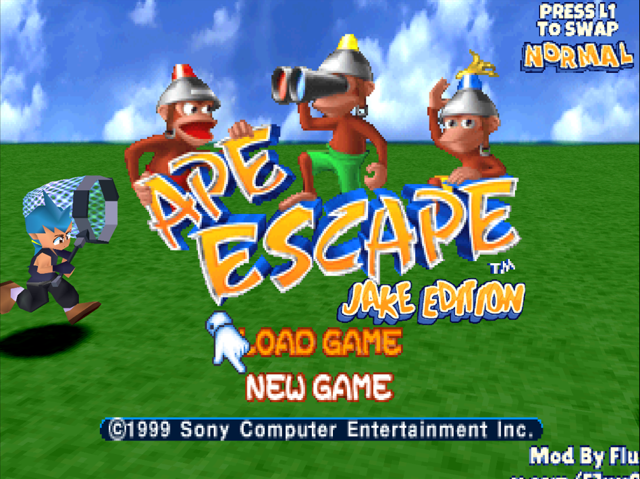

<div align="center">

# 🟣 Ape Escape — Play as Jake

**A fan mod for Ape Escape (PlayStation, 1999): play the whole game as Jake.**


%20SCUS--94423-f0a020?style=for-the-badge)



*Mod by **Flux** · [x.com/F1ux0r](https://x.com/F1ux0r)*

</div>

> [!WARNING]
> **Work in progress.** Expect bugs, and the game may crash. Save often, and please report problems on the [Issues](../../issues) page.

---

## ✨ What it does

Spike wears **Jake's model everywhere**: in levels, cutscenes and on the title screen, which now reads **JAKE EDITION**. When Jake turns up in a level, he wears Spike's. Controls, animation and AI are unchanged; only the look changes.

- 🔁 **Two looks.** Press **L1** on the title screen to swap:
  - **NORMAL:** Jake before Specter gets to him, as in the opening.
  - **BRAINWASHED:** Jake as he races you.
- 🧢 **His HUD.** Jake's face, lives icon and health flame, and the extra-life pickup becomes his shirt.
- 💜 **Purple gadgets.** The Stun Club, Time Net, gadget icons and more take Jake's purple.
- 🗣️ **His voice.** Jake's jump yell and his "ouch" replace Spike's, and Spike's lines that Jake doesn't say are muted.
- 💿 **Nothing copied from the game.** Jake's model, face and voice are read from **your own disc** when the game starts.

<p align="center">
  
  
  
</p>

---

## 🎮 Pick your version

| | 🖥️ **PC version** (ApeEscapeRecomp) | 🕹️ **Emulator version** (DuckStation) |
|---|---|---|
| **What it is** | A native Windows build of the game ([ApeEscapeRecomp](https://github.com/mstan/ApeEscapeRecomp)) with the mod built in | A patch (PPF) for your disc image, played in [DuckStation](https://github.com/stenzek/duckstation) |
| **Extras** | Widescreen, frame smoothing and the recomp's other options; each save remembers the look it was made with | Your usual emulator setup, save states, controllers |
| **Needs** | Windows 10/11 (64-bit) | DuckStation with **8MB RAM** turned on and a **200% CPU overclock** (see below) |
| **Your disc** | Ape Escape (USA), SCUS-94423, as `.cue` + `.bin` | The Redump **Ape Escape (USA)** single `.bin` image |

Either way you need **your own legally obtained copy** of Ape Escape (USA). Nothing from the game is included.

---

## 🖥️ PC version

1. Download **`ApeEscapeRecomp-PlayAsJake-windows-x64.zip`** from [Releases](../../releases) and extract it anywhere.
2. Run **`ApeEscapeRecomp.exe`**. The launcher opens.
   - If Windows SmartScreen or Smart App Control blocks it, that's because the build isn't code-signed. On SmartScreen, choose *More info → Run anyway*.
3. In the **Disc** row, pick your Ape Escape (USA) `.cue`. Leave the BIOS on OpenBIOS, or pick your own `SCPH1001.BIN`.
4. On the **Mods** page, turn on **Ape Escape Play as Jake**.
5. Press **Launch**, then pick your look with **L1** on the title screen.

---

## 🕹️ Emulator version

### 1. Get the patch

From [Releases](../../releases), download **`ApeEscape-PlayAsJake-DuckStation8MB.ppf`**.

### 2. Patch a copy of your disc

The patch is for the **Redump Ape Escape (USA)** image: a single `Ape Escape (USA).bin` (SHA-256 `1ae17e78…852a`). Use any of these:

- **In your browser:** [Rom Patcher JS](https://www.marcrobledo.com/RomPatcher.js/). Open the `.bin` as the ROM and the `.ppf` as the patch, then apply.
- **On Windows:** PPF-O-Matic.
- **With Python:** `python emulator/apply_ppf.py "Ape Escape (USA).bin" "<patch>.ppf" "Ape Escape (USA) [Jake].bin"`. This checks your image first and also writes a `.cue`.

If you only end up with a `.bin`, put a `.cue` next to it with the same name:

```
FILE "Ape Escape (USA) [Jake].bin" BINARY
  TRACK 01 MODE2/2352
    INDEX 01 00:00:00
```

### 3. Set up DuckStation (Ape Escape only)

The mod lives in the extra memory of a PlayStation dev console. Turn these on just for Ape Escape:

- **Easiest:** copy [`emulator/SCUS-94423.ini`](emulator/SCUS-94423.ini) into DuckStation's `gamesettings` folder (on Windows, `%LOCALAPPDATA%\DuckStation\gamesettings\`).
- **Or by hand:** right-click Ape Escape → **Game Properties**, then turn on:
  - **Enable 8MB RAM (Dev Console)**
  - **Enable Clock Speed Control (Overclocking/Underclocking)**, set to **200%**

Without 8MB RAM the patched disc plays the original game.

### 4. Play

Open the patched `.cue` in DuckStation. The mod takes a few extra seconds to load at boot. Every boot starts with the **NORMAL** look; press **L1** on the title screen to switch.

---

## ❤️ Credits

| | |
|---|---|
| 🛠️ **Mod** | **Flux** · [x.com/F1ux0r](https://x.com/F1ux0r) · [github.com/F1ux0r](https://github.com/F1ux0r) |
| 🐒 **Ape Escape** | © 1999 **Sony Computer Entertainment Inc.**, developed by **SCE Japan Studio**. |
| 🎮 **PlayStation** | "PlayStation" and the PlayStation logos are trademarks of **Sony Interactive Entertainment Inc.** |
| 🖥️ **ApeEscapeRecomp / PSXRecomp** | The PC recompilation this mod is built on, by **[mstan](https://github.com/mstan)**: [ApeEscapeRecomp](https://github.com/mstan/ApeEscapeRecomp), [PSXRecomp](https://github.com/mstan/psxrecomp) |
| 💾 **OpenBIOS** | From **[PCSX-Redux](https://github.com/grumpycoders/pcsx-redux)** (MIT), included with the PC version |
| 🕹️ **DuckStation** | The emulator the emulator version is made for, by **[Stenzek](https://github.com/stenzek/duckstation)** |
| 🔧 **Toolchain** | MIPS GCC from **[PSn00bSDK](https://github.com/Lameguy64/PSn00bSDK)**, used to build the emulator version |

Unofficial fan project, **not affiliated with, endorsed or sponsored by Sony** or any of the projects above. No game data, BIOS or copyrighted assets from Ape Escape are included. Please support the official releases.

> 📚 This repository is a fork of ApeEscapeRecomp with the mod added (`src/mods/ape_play_as_jake_plugin.c`, `mods/preloaded/packages/ape.enhancement.play-as-jake`). The recomp's own README is kept in [`RECOMP_README.md`](RECOMP_README.md).
